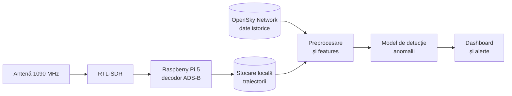

<div align="center">

# ✈️ Stație ADS-B cu detecție AI a traiectoriilor anormale

**Un receptor de trafic aerian construit acasă, care învață cum zboară avioanele normal și observă când ceva nu arată bine.**


Lucrare de licență · Universitatea Titu Maiorescu, Facultatea de Informatică · 2027

</div>

---

## 📡 Despre ce e vorba

Avioanele își transmit singure, de câteva ori pe secundă, poziția, altitudinea, viteza și direcția, prin semnale **ADS-B** pe frecvența de 1090 MHz. Cu o antenă mică și un stick **RTL-SDR** conectat la un **Raspberry Pi 5**, aceste semnale pot fi recepționate de pe un simplu balcon.

Proiectul are două părți:

1. **Stația de recepție.** Raspberry Pi-ul decodează mesajele ADS-B, reconstruiește traiectoria fiecărui zbor și le salvează local.
2. **Detecția anomaliilor.** Un model de învățare automată, antrenat pe traiectorii istorice de la [OpenSky Network](https://opensky-network.org/), învață tiparul zborurilor obișnuite și semnalează ce iese din tipar.

## 🔍 Ce înseamnă o traiectorie „anormală”

| Tip | Exemplu |
|---|---|
| Circuite de așteptare neobișnuite | un avion care face cercuri mult peste durata normală |
| Coborâri sau urcări bruște | variații de altitudine peste ce e tipic fazei de zbor |
| Abateri de la rută | ieșiri semnificative din culoarele uzuale |
| Pierderi de semnal | transponder oprit sau mesaje lipsă pe porțiuni lungi |
| Date imposibile fizic | salturi de poziție, viteze nerealiste (posibil spoofing) |

## 🏗️ Arhitectură



- **Antrenare:** date istorice OpenSky pentru zona României.
- **Testare:** date reale capturate de stația proprie, pe care modelul nu le-a văzut niciodată.

## 🧰 Tehnologii

| Zonă | Unelte |
|---|---|
| Hardware | Raspberry Pi 5, RTL-SDR, antenă 1090 MHz |
| Recepție | readsb / dump1090, pyModeS |
| Date | pandas, SQLite / Parquet, OpenSky (Trino) |
| Învățare automată | scikit-learn, PyTorch |
| Vizualizare | dashboard web cu hartă |

## 📁 Structura proiectului

```
station/      configurarea Raspberry Pi-ului, decodorul și colectarea datelor
data/         scripturi pentru descărcarea datelor (datele brute nu se urcă aici)
notebooks/    explorarea datelor și experimente
src/          preprocesare, extragerea caracteristicilor, modele
dashboard/    vizualizarea zborurilor și a anomaliilor
docs/         documentația lucrării
```

## 🗺️ Progres

- [ ] Asamblarea stației (Raspberry Pi 5 + RTL-SDR + antenă)
- [ ] Decodor ADS-B funcțional și colectare continuă de date
- [ ] Acces la datele istorice OpenSky
- [ ] Preprocesarea traiectoriilor
- [ ] Modelul de detecție a anomaliilor
- [ ] Evaluarea pe datele stației proprii
- [ ] Dashboard
- [ ] Lucrarea scrisă și susținerea

## 🙏 Mulțumiri

- [OpenSky Network](https://opensky-network.org/) pentru accesul la datele istorice de trafic aerian.
- Coordonatorului științific, pentru îndrumare și pentru receptorul RTL-SDR.

---

<div align="center">
<sub>Realizat de <a href="https://github.com/infinite-alex">@infinite-alex</a> ca lucrare de licență.</sub>
</div>
